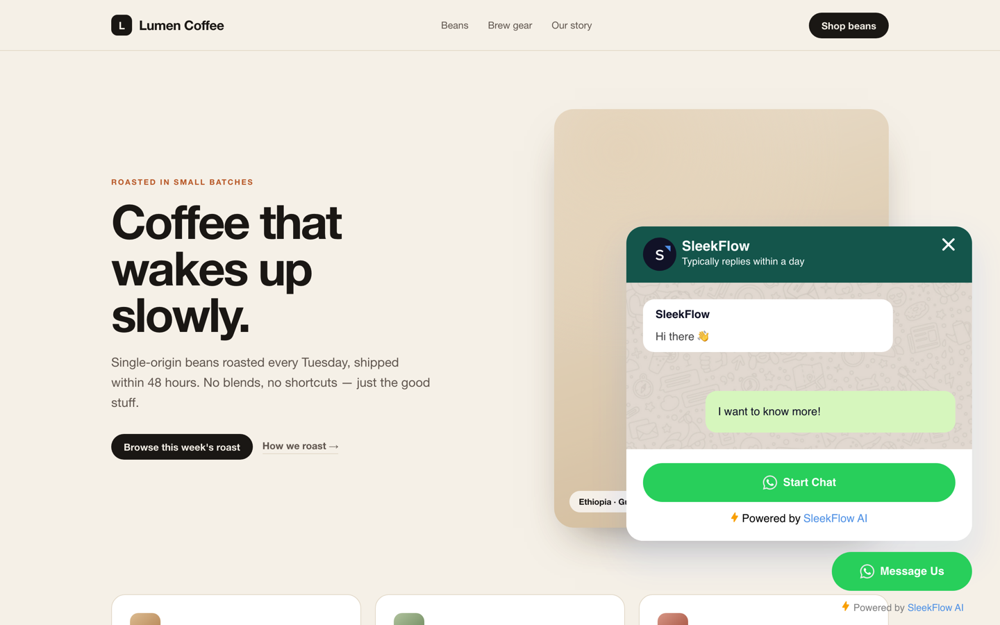
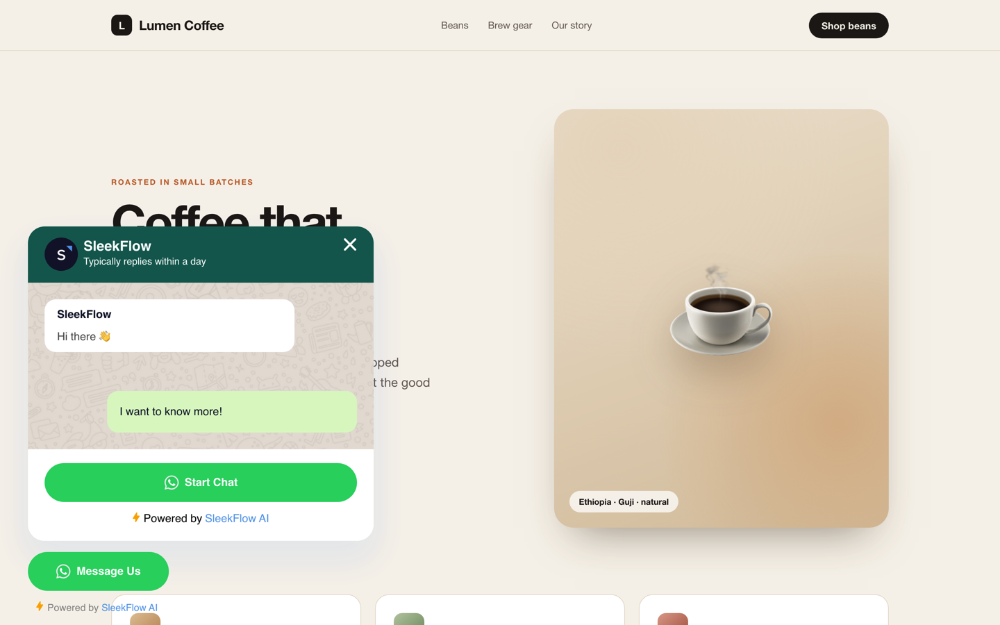
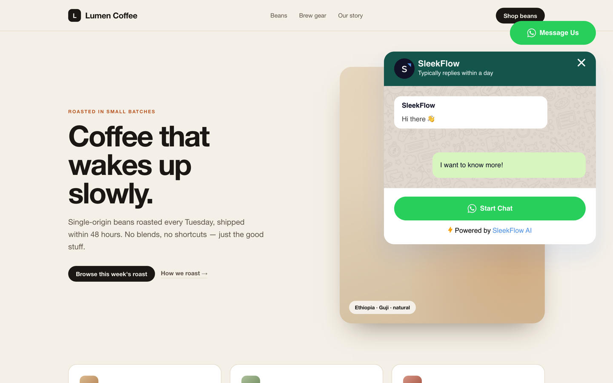
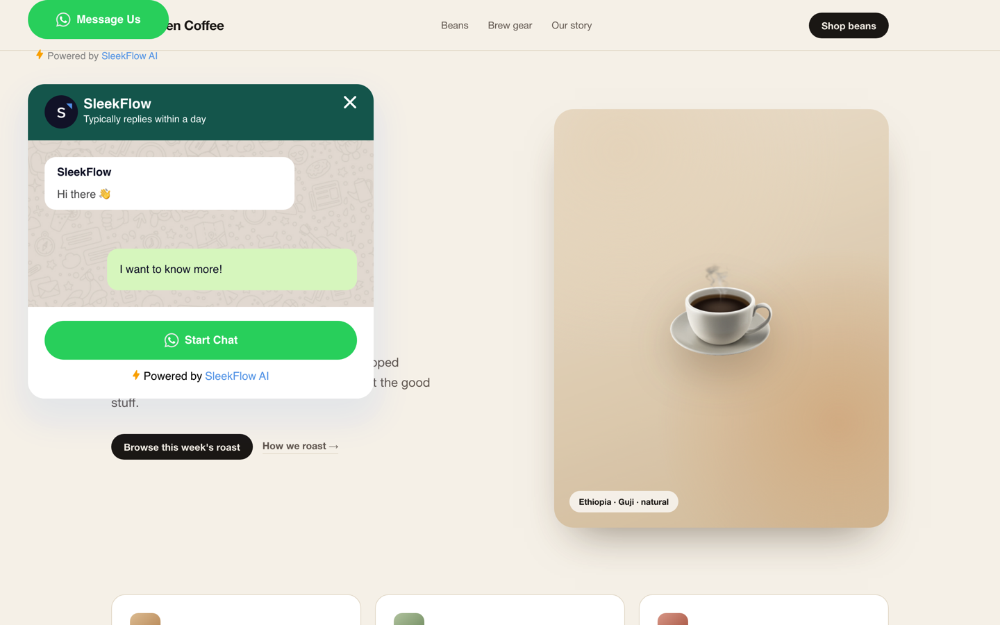
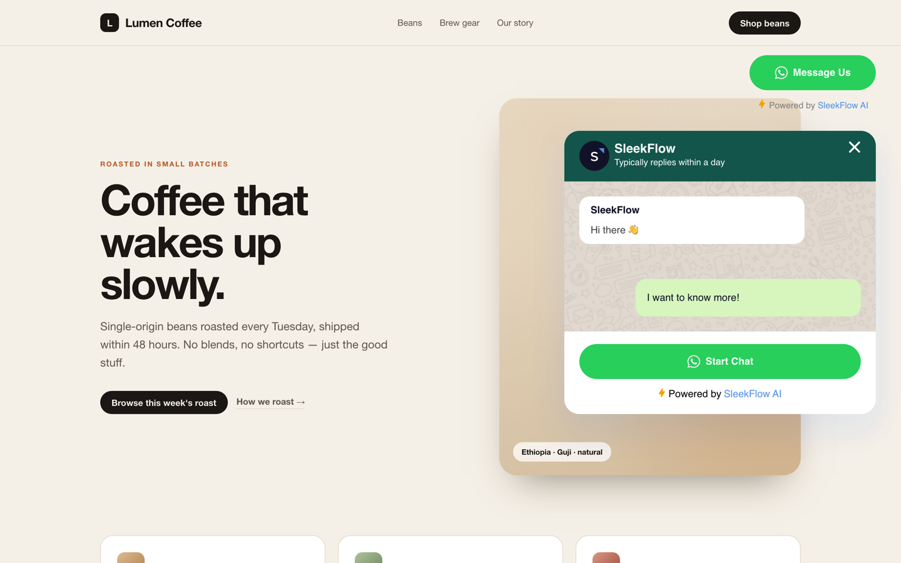
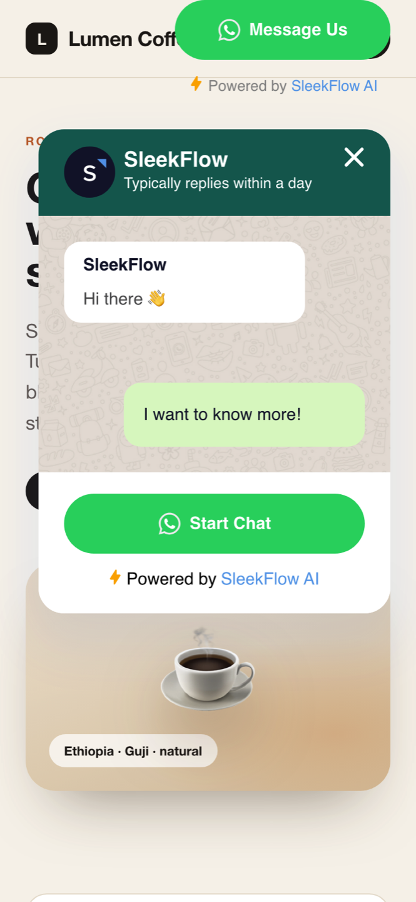
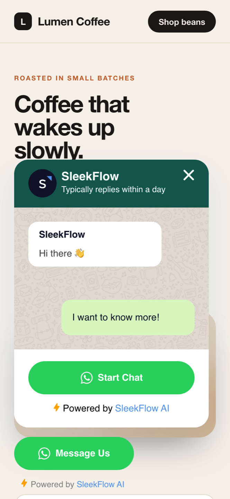

# SleekFlow WhatsApp Button — any corner

A drop-in, self-hosted build of [SleekFlow's WhatsApp button](https://sleekflow.io/whatsapp-button.js)
that can sit in any of the four viewport corners.

The chat window follows the button: it opens **upward** from the bottom corners and
**downward** from the top corners, and shrinks on short viewports instead of running
off-screen.

| bottom-right | bottom-left |
| :---: | :---: |
|  |  |
| **top-right** | **top-left** |
|  |  |

---

## Quick start

```html
<script
  src="https://jabircode.github.io/sleekflow-whatsapp-widget/whatsapp-button.js"
  async
  onload="whatsappButton({
    position: 'top-right',
    buttonName: 'Message Us',
    buttonIconSize: '22',
    brandImageUrl: 'https://sleekflow.io/static/images/sleekflow-icon.png',
    brandName: 'SleekFlow',
    brandSubtitleText: 'Typically replies within a day',
    buttonSize: 'large',
    callToAction: 'Start Chat',
    phoneNumber: '12525126882',
    welcomeMessage: 'Hi there 👋',
    prefillMessage: 'I want to know more!'
  })"
></script>
```

Drop it in before `</body>`. Nothing else changes — the option names are the same as
the official script, and `position` is the only new one you need.

Without a `position` the widget behaves exactly like the official one (bottom-right).

---

## Positions

| `position` | Button | Chat window opens |
| --- | --- | --- |
| `bottom-right` *(default)* | bottom-right | upward, right-aligned |
| `bottom-left` | bottom-left | upward, left-aligned |
| `top-right` | top-right | downward, right-aligned |
| `top-left` | top-left | downward, left-aligned |

Shorthands are accepted too: `br`, `bl`, `tr`, `tl`, `left`, `right`. Case and
separators are ignored, so `'topLeft'`, `'top left'` and `'TOP_LEFT'` all work.

The official `buttonPosition: 'left' | 'right'` option still works and maps to the
two bottom corners. If both are given, `position` wins.

---

## Options

### New

| Option | Value | Default |
| --- | --- | --- |
| `position` | `'bottom-right'` · `'bottom-left'` · `'top-right'` · `'top-left'` | `'bottom-right'` |
| `offsetX` | Horizontal inset from the viewport edge. Number = px, string = any CSS length (`'2rem'`). | `40` desktop, `24` ≤ 640px |
| `offsetY` | Vertical inset from the viewport edge. | `0` |
| `zIndex` | Stacking order. | `99999` |

### Unchanged from the official script

`brandName`, `buttonName`, `brandSubtitleText`, `welcomeMessage`, `phoneNumber`,
`brandImageUrl`, `callToAction`, `buttonSize`, `buttonIconSize`, `prefillMessage`,
`poweredByColor`.

### Runtime

```js
const widget = whatsappButton({ position: 'top-left' });

widget.open();
widget.close();
widget.hide();
widget.show();

widget.addEventListener('widget-opened', () => {});
widget.addEventListener('widget-closed', () => {});

// Move it later without rebuilding:
widget.setAttribute('position', 'bottom-left');
```

Calling `whatsappButton()` again replaces the existing widget.

---

## Top placement and sticky headers

Like the official widget, the launcher sits flush with the vertical edge — `offsetY: 0`
at the top. Most sites have a sticky header there, so top placements will usually want
a vertical inset:

```js
whatsappButton({ position: 'top-right', offsetY: 88 });
```

| `offsetY: 0` (default) | `offsetY: 88` |
| :---: | :---: |
|  |  |

`offsetX` / `offsetY` also apply on mobile unless you pass a value yourself — pass one
and it is used at every breakpoint.

On phones the panel drops to `24px` from the side edges and is capped to the viewport
height, so it stays usable on landscape screens:

| top-right on iPhone | bottom-left on iPhone |
| :---: | :---: |
|  |  |

---

## How it works

- Same custom element (`<sleekflow-whatsapp-widget>`) and the same shadow-DOM markup
  and CSS as the official widget, so the look is unchanged.
- The host element is `position: fixed` and is anchored from one horizontal + one
  vertical edge (`left`/`right` × `top`/`bottom`).
- For top placements the launcher and panel swap places with flex `order`, so the
  launcher stays put and the panel opens underneath it — the button never jumps when
  the chat opens.
- The panel height is `453px` but capped at `100dvh - offsetY - 141px`, and its body
  scrolls, so short windows don't push the panel off-screen.
- Styles are scoped in a shadow root, so host-page CSS can't leak in.

Fonts, the chat background texture and the default icon are loaded from
`sleekflow.io` and `fonts.gstatic.com`, exactly like the official script — this repo
hosts code only.

---

## Files

```
whatsapp-button.js   the widget (no build step, ~25 KB)
index.html           landing page + live playground
demo.html            sample store page, supports ?position=&open=1
tools/shoot.mjs      CDP screenshot harness used for the images above
screenshots/         the images in this README
```

### Local development

```bash
python3 -m http.server 8900
# then open http://127.0.0.1:8900/index.html
```

`demo.html?position=top-left&open=1` renders any placement with the chat already open.
The screenshots are captured with `tools/shoot.mjs`, which drives the Chrome instance
from `~/.dsh/chrome/` over CDP.

---

## Hosting

Static files on GitHub Pages: push to `main`, Pages serves the repo root.

```
https://jabircode.github.io/sleekflow-whatsapp-widget/whatsapp-button.js
```

To use your own domain or repo, change the `src` in the embed snippet — there is no
hard-coded URL inside the widget.

---

## Notes

- Browser support: anything with Custom Elements v1 and Shadow DOM v1 (Chrome 54+,
  Firefox 63+, Safari 10.1+).
- The design, copy and assets are SleekFlow's; this build only adds placement options
  on top of the official widget.
